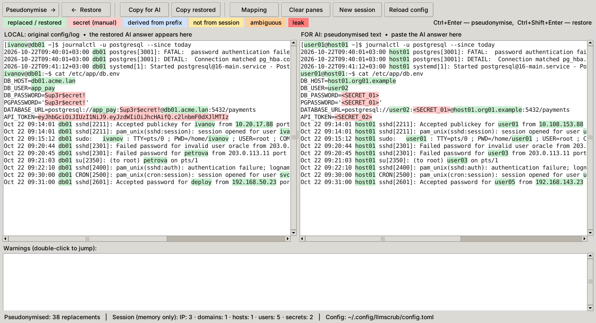
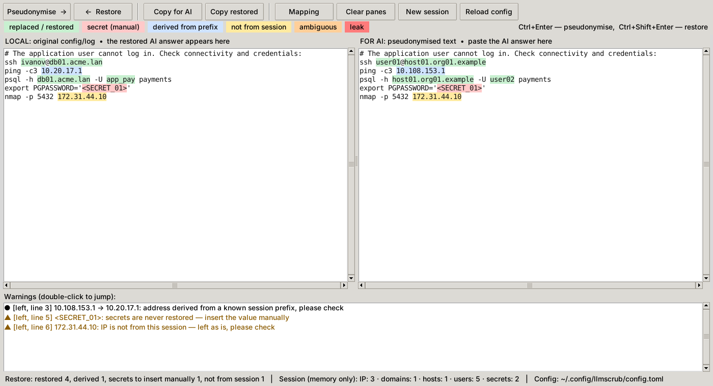

# llmscrub

**Local, reversible pseudonymisation of Linux configs and logs before you paste them into an AI chat.**

[Русская версия](README.ru.md)

You audit or troubleshoot servers and want help from ChatGPT, Claude or another AI — but you must not disclose internal IP addresses, domains, host names, user names or secrets (PCI DSS, NDA, plain common sense). llmscrub replaces them with consistent pseudonyms, keeps the structure intact so the AI can still reason about it, and then **translates the AI's answer back** to your real values.

Everything runs locally: no network access, no dependencies beyond the Python standard library and Tk. The mapping lives only in the memory of the window.



## How it works

1. Paste a config, log or command output into the **left** pane and press **Pseudonymise →** (Ctrl+Enter).
2. The **right** pane shows the same text with every sensitive value replaced: `db01.acme.lan` → `host01.org01.example`, `ivanov` → `user01`, `10.20.17.88` → `10.211.144.88`, passwords → `<SECRET_01>`. The same value always gets the same pseudonym, so the AI sees a coherent picture.
3. **Copy for AI** runs a leak check first: if any original value or an unmasked IP is still in the text, it is highlighted and the copy needs confirmation.
4. Paste the AI's answer into the **right** pane and press **← Restore** (Ctrl+Shift+Enter). The left pane now contains the answer with your real values.



Before you run anything, check the highlighting on the left:

| Colour | Meaning |
|---|---|
| green | replaced / restored from the session mapping |
| blue | address **derived** from a known prefix — e.g. the AI suggested the gateway `.1` of a pseudonymised subnet; subnets are preserved, so it maps back correctly |
| yellow | not from this session (invented by the AI or taken from an example) — left as is |
| orange | ambiguous — the candidates are listed in the warnings |
| red | a secret placeholder such as `<SECRET_01>` — secrets are never restored, insert the value yourself |

Nothing is ever executed automatically.

## Installation

Requirements: Linux, Python 3.11 or newer with Tk.

```bash
sudo apt install python3-tk pipx git      # Debian / Ubuntu
pipx ensurepath                           # once; then open a new terminal
pipx install git+https://github.com/evgenben/llmscrub
llmscrub init-config                      # creates ~/.config/llmscrub/config.toml (mode 0600)
nano ~/.config/llmscrub/config.toml       # add your DNS suffixes and company name
llmscrub                                  # opens the window
```

On other distributions install the Tk bindings for Python (`python3-tkinter` on Fedora, `tk` on Arch). Update with `pipx upgrade llmscrub`. Without pipx: clone the repository and run `./bin/llmscrub`.

**Fill in the config.** Without your internal DNS suffixes and company name, domains and Kerberos realms are barely detected. Never paste the config itself into an AI.

## Language

The interface is available in English and Russian. It follows the system locale (`LANG`, `LC_MESSAGES`, `LC_ALL`, `LANGUAGE`); override it with `LLMSCRUB_LANG=en|ru` or `--lang en|ru`.

## What is replaced

| What | Where it is found | Replacement | Reversible |
|---|---|---|---|
| IPv4 addresses, CIDRs, netmasks | everywhere; `a.b.c.d/NN`, `addr mask` | class- and prefix-preserving, last octet kept | yes |
| PTR zones | `30.20.10.in-addr.arpa` | consistent with the IPs | yes |
| FQDNs under your suffixes | everywhere | `host01.zone01.org01.example` | yes |
| Kerberos realms, LDAP DNs | `ACME.LAN`, `dc=acme,dc=lan` | `ORG01.EXAMPLE`, `dc=org01,dc=example` | yes |
| Short host names | syslog prefix, shell prompt, `/etc/hosts`, fstab, rsyslog, URIs, ssh_config, config | `host01` | yes |
| User names | auth.log, sudo, su, PAM, audit, passwd/shadow/group, sudoers, AllowUsers, sssd, `/home/x`, e-mail, principals, `ls -l`, `id`, `last` | `user01` | yes |
| Person names | LDIF `cn/sn/givenName/displayName`, GECOS | `name01` | yes |
| Configured strings | case-insensitive substrings, also inside paths and certificate subjects | `org01` | yes |
| Passwords and tokens | `key = value` by keyword, `user:pass@` in URIs, `Authorization`, `.netrc`, `sasl_passwd`, `curl -u`, `mysql -p`, `sshpass`, SNMP communities, PSKs, JWTs, cloud keys | `<SECRET_n>` | **no** |
| Password hashes | `$y$`, `$6$`, `$2b$`, `{SSHA}` … | `<HASH_n>` | **no** |
| Keys and certificates | PEM blocks, OpenVPN inline blocks | `<KEY_n>`, `<CERT_n>` | **no** |
| Card numbers | 13–19 digits passing the Luhn check | `<PAN_n>` | **no** |
| audit.log hex fields | `proctitle=`, `cmd=`, `acct=` … | decoded, pseudonymised, re-encoded | — |

Identical secrets get identical placeholders: the AI can see that a password is reused, but not the password.

**Left untouched:** loopback, `0.0.0.0`, netmasks, multicast, link-local, the documentation ranges, addresses listed in `ips.keep`, system accounts (`root`, `www-data`, `sshd` …), generic DNS labels (`www`, `mail`, `ldap`, `prod` …), MAC addresses, booleans and PAM lines (`password requisite pam_deny.so`), paths to key files.

## Command line

```bash
journalctl -u nginx --since today | llmscrub mask > for_ai.txt
llmscrub unmask < ai_answer.txt
llmscrub check < something.txt         # exit code 1 if original values are found
llmscrub session show | clear
```

The CLI keeps its mapping in `$XDG_RUNTIME_DIR/llmscrub/session.json` — tmpfs, removed at logout, mode 0600. If `mask` finds a leak in its own output, the output is blocked (exit code 2); `--force` prints it anyway.

## Limitations

- Detection is rule-based. **Always review the right pane before sending it.**
- Without a config, domains and realms are barely detected.
- A secret without a keyword (a password in free text, an argument of an unusual tool) is not found. The leak check catches it only if the same secret was already found earlier in the session.
- Base64 and other encodings are not decoded, except audit.log hex fields. Basic auth is caught through the `Authorization` header.
- Four-number version strings (`6.8.0.45`) look like IPs and are replaced.
- IPv6 is not handled.
- For public networks shorter than /24, subnet nesting may not be preserved; for private networks it always is.
- An `a.b.c.0` address without a mask may, rarely, restore ambiguously; such places are flagged.
- Structure stays visible on purpose — number of hosts, ports, software versions, paths. Otherwise the AI could not analyse anything.
- **Clipboard history.** Clipboard managers (for example Clipboard History for GNOME) store everything you copy, including the original configs. Disable them while you work. The window clears the clipboard when it closes.
- Closing the window discards the mapping: answers to earlier texts can no longer be restored.

## Compliance

llmscrub is a technical control. It does not by itself authorise sending data to an external AI service. Describe the process in your audit documentation — what data, how it is pseudonymised, who reviews the result — and agree it with whoever owns the policy (and your QSA, for PCI DSS).

## Reporting problems

Use **fictional data only** — never real configs or logs, not even partially redacted. See [SECURITY.md](SECURITY.md).

## Development

```bash
python3 -m unittest -v tests.test_engine
```

The tests use only invented data from `tests/samples/`. They check that no original value survives in the output, that restoring gives back the original text (except secrets), and the properties of the IP mapping. Real public addresses are generated at run time, so the repository contains none.

## License

[MIT](LICENSE)
